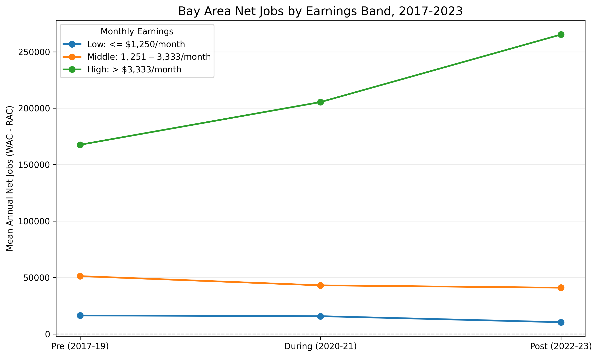
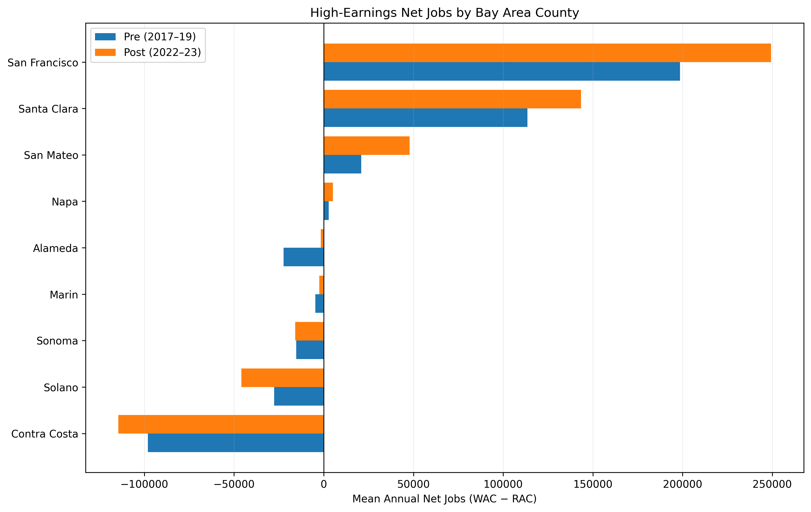

# HF2b — Hypothesis 3: Earnings-Band Net Jobs

## Research Question

How did the spatial balance of jobs across earnings bands change in the nine-county San Francisco Bay Area before, during, and after COVID-19?

## Data and Methods

We use LEHD LODES Workplace Area Characteristics (WAC) and Residence Area Characteristics (RAC) data from 2017 to 2023.

Net jobs are calculated as:

**Net Jobs = WAC − RAC**

Positive values indicate more jobs located in an area than employed residents in the corresponding earnings band. Negative values indicate the opposite.

We compare mean annual net jobs across three periods:

- Pre-pandemic: 2017–2019
- During pandemic: 2020–2021
- Post-pandemic: 2022–2023

Earnings bands follow the LODES categories:
- Low (CE01): $1,250/month or less
- Middle (CE02): $1,251–$3,333/month
- High (CE03): More than $3,333/month

## Figure 1 — Regional Trends by Earnings Band

**Caption:** Mean annual net jobs (WAC − RAC), aggregated across the nine Bay Area counties, by earnings band and pandemic period.

The regional net-job balance increased substantially for the high-earnings category between the pre-pandemic and post-pandemic periods. In contrast, the low- and middle-earnings categories showed declines in their positive net-job balances.

This suggests that the spatial distribution of workplaces relative to employed residents changed differently across earnings bands.

## Figure 2 — High-Earnings Net Jobs by County

**Caption:** Mean annual high-earnings net jobs (WAC − RAC) by Bay Area county, comparing 2017–2019 with 2022–2023.

San Francisco and Santa Clara remained major positive net-job centers for high-earnings employment, with larger positive balances after the pandemic. San Mateo also showed an increase.

Contra Costa and Solano had negative balances in both periods, with larger negative balances after the pandemic.

These differences suggest that high-earnings employment remained geographically concentrated, while the relationship between workplace locations and workers' residences varied across counties.

## Limitations

- Net jobs measure the difference between workplace-based and residence-based employment counts; they do not directly measure individual commuting flows.
- The earnings categories use fixed LODES thresholds and are not adjusted for inflation.
- Period averages describe changes over time but cannot establish that the pandemic caused those changes.
- County-level aggregation may conceal substantial differences between census tracts.

## Preliminary Conclusion

The findings show a divergence across earnings bands in the Bay Area's net-job balance between 2017 and 2023. High-earnings net jobs became more concentrated in major employment counties, especially San Francisco and Santa Clara, while several surrounding counties continued to have negative balances.

Further tract-level analysis is needed to understand the neighborhood-scale geography of these changes.
