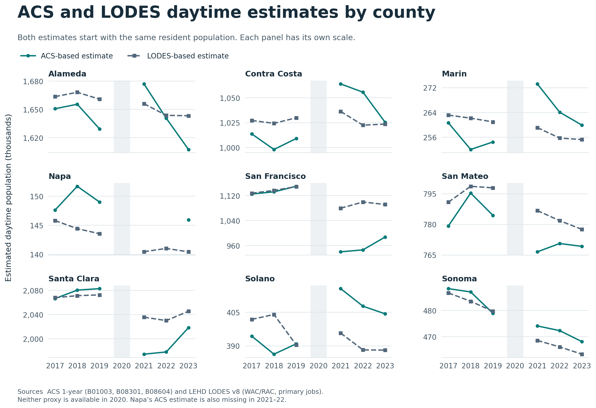
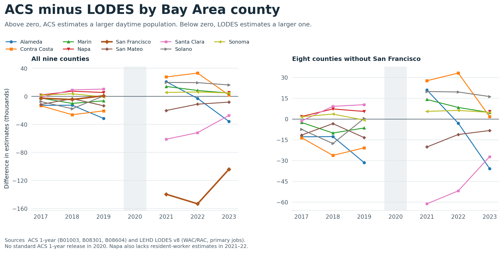
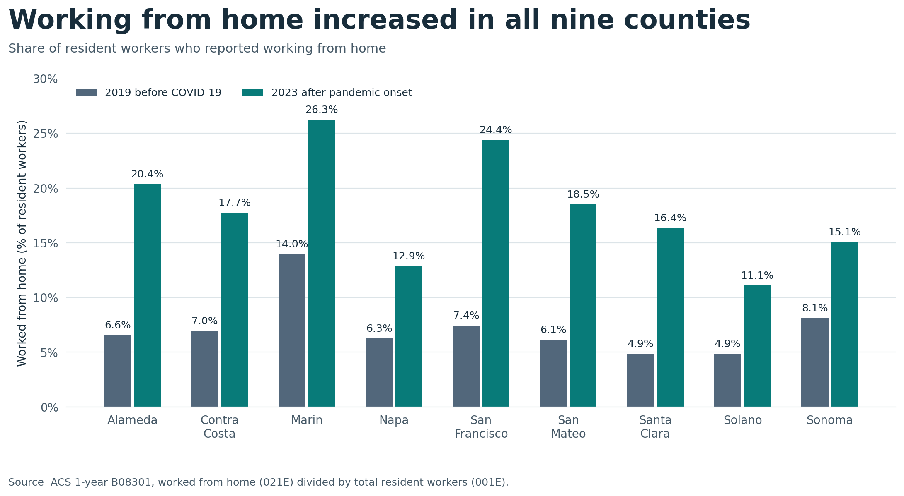

# Hypothesis 2 — Daytime population and work from home

H2 asks whether the rise in working from home after 2020 helps explain why employer-based LODES and worker-reported ACS daytime population estimates diverged. The direction can depend on whether a county is home to the worker or to the employer.

## How we estimate daytime population

Both estimates start with the same ACS resident population for the county and year.

- **ACS daytime estimate** = resident population **+** workers who report working in the county **−** workers who live in the county, regardless of where they report working.
- **LODES daytime estimate** = resident population **+** primary jobs recorded at workplaces in the county **−** primary jobs held by people who live in the county, regardless of where those jobs are recorded.

The gap is **ACS minus LODES**. A positive number means ACS estimates a larger daytime population. A negative number means LODES estimates a larger one.

## Meaning

The share of resident workers reporting that they worked from home rose in all nine counties from 2019 to 2023. San Francisco, San Mateo, and Santa Clara are major Bay Area tech and office job centers. If someone who used to commute from Marin to a San Francisco office starts working from home, ACS can count the worker at their home location while LODES can still record the job at the San Francisco office. That would push **ACS minus LODES down in San Francisco and up in Marin**. [MTC Vital Signs jobs by industry](https://vitalsigns.mtc.ca.gov/indicators/jobs-by-industry)

**San Francisco shows the clearest pattern.** Its ACS daytime estimate fell from **1,150,041 to 987,724** (−162,317), while its LODES estimate fell from **1,149,236 to 1,091,752** (−57,484). The ACS estimate of workers at San Francisco workplaces fell by **155,381**, while LODES recorded **22,691 fewer primary jobs** at those workplaces. The daytime estimates were nearly equal in 2019. By 2023, ACS was **104,028 below LODES**.

**Santa Clara and San Mateo show different versions of the pattern.** In Santa Clara, the ACS workplace-worker estimate fell by **27,602** while LODES primary jobs by workplace rose by **19,520**. Its daytime gap flipped from **+10,339 to −27,187**, consistent with the proposed shift. In San Mateo, the ACS workplace-worker estimate fell by **9,833** while LODES primary jobs by workplace rose by **2,099**. Still, its daytime gap narrowed from **−13,448 to −8,317** because the full LODES daytime estimate fell more than the ACS estimate. The daytime formulas also account for changes in the residents who hold jobs or report working.

**Alameda is a mixed case.** In 2019, LODES recorded about **111,000 Alameda residents with jobs in San Francisco** and **107,000 with jobs in Santa Clara**, alongside about **100,000 Contra Costa residents with jobs in Alameda**. Alameda was both a source of workers for other job centers and a job center itself. By 2023 its ACS workplace-worker estimate had risen, yet its full ACS daytime estimate fell and stayed below LODES. [2019 county commuting corridors](../outputs/tables/od_top_county_corridors.csv)

**Contra Costa and the northern counties generally moved toward a higher ACS estimate relative to LODES.** Contra Costa, Marin, and Sonoma moved from negative to positive gaps. Solano’s already positive gap grew, while Napa’s stayed close to its 2019 level. In Contra Costa, Marin, and Solano the ACS daytime estimate rose and the LODES estimate fell. In Sonoma both fell, with LODES falling more. These shifts are consistent with some work moving closer to home, and the county totals leave room for other explanations.

| County | Worked from home in 2019 | Worked from home in 2023 | ACS minus LODES in 2019 | ACS minus LODES in 2023 |
| --- | ---: | ---: | ---: | ---: |
| San Francisco | 7.4% | 24.4% | +805 | −104,028 |
| Santa Clara | 4.9% | 16.4% | +10,339 | −27,187 |
| San Mateo | 6.1% | 18.5% | −13,448 | −8,317 |
| Alameda | 6.6% | 20.4% | −31,511 | −35,789 |
| Contra Costa | 7.0% | 17.7% | −20,765 | +1,729 |
| Marin | 14.0% | 26.3% | −6,469 | +4,655 |
| Napa | 6.3% | 12.9% | +5,447 | +5,505 |
| Solano | 4.9% | 11.1% | +467 | +16,199 |
| Sonoma | 8.1% | 15.1% | −780 | +4,798 |

Across all nine counties, the unweighted Pearson correlation between the 2023 resident work-from-home share and the 2019–2023 change in ACS minus LODES was **−0.34**. It flipped to **+0.21** without San Francisco. For this comparison, each year’s gap is expressed as a percentage of that year’s ACS estimate. The work-from-home share describes where workers live, which helps explain why a single regional correlation can miss the distinction between workers’ home counties and their employers’ counties.

## Caveats

**This shows association, not cause.** The nine county totals and the commuting corridors cover workers across industries. They cannot identify which former commuters switched to remote work or whether the change was concentrated in tech. Job losses, changes in industry mix, and employer reporting practices could also affect the gap. ACS records usual commuting mode, so it can miss some hybrid work. Both daytime estimates are proxies for how many people are present. The charts use point estimates, without propagating ACS margins of error to the gaps, shares, or correlations.

There is no standard 2020 ACS 1-year release, so both daytime proxies have a break in 2020 because both require ACS resident population. Napa lacks published ACS resident-worker estimates in 2021 and 2022, leaving its ACS proxy and the difference unavailable in those years. All nine counties have both estimates in 2019 and 2023.

## Follow-up

Use 2019 county-to-county commuting flows to measure which counties sent the largest share of their resident workers to San Francisco, San Mateo, and Santa Clara. Test whether those counties saw larger increases in ACS minus LODES after 2020. Compare industry groups where the data allow and account for local employment changes. Workplace attendance data or records linking workers’ home and employer locations would help test whether the shifts reflect remote work.

## Final figures and exact inputs

### Figure 1 — ACS and LODES daytime estimates by county

I plotted `daytime_proxy_acs` and `daytime_proxy_lodes` in thousands for each county and year. Both start with the same ACS resident population. ACS adds workers by workplace and subtracts workers by residence. LODES adds primary jobs by workplace and subtracts primary jobs by residence. The panels use separate vertical scales so both series can be read in each county. [HY2a county panel](../outputs/tables/hy2a_county_2017_2023.csv)

### Figure 2 — ACS minus LODES over time

I subtracted `daytime_proxy_lodes` from `daytime_proxy_acs` for each county-year and plotted the difference in thousands. Positive values mean ACS estimates a larger daytime population. The second panel uses a tighter scale for the eight counties outside San Francisco. [HY2a county panel](../outputs/tables/hy2a_county_2017_2023.csv)

### Figure 3 — Work from home before and after COVID-19 onset

Each bar uses only ACS 1-year table B08301 for its county and year. The numerator is workers age 16 and older who reported working from home (`B08301_021E`). The denominator is all resident workers age 16 and older (`B08301_001E`). For example, San Francisco went from 39,124 of 526,022 resident workers in 2019 (**7.4%**) to 112,342 of 460,397 in 2023 (**24.4%**). [Processed ACS county estimates](../data/processed/acs1_county_2017_2024.csv)

## Data lineage and checks

| Input | Exactly what it contributes |
| --- | --- |
| [ACS 1-year county estimates](../data/processed/acs1_county_2017_2024.csv) | `B01003_001E` supplies the same annual resident population to both proxies. The ACS proxy adds workers by workplace (`B08604_001E`) and subtracts resident workers (`B08301_001E`). `B08301_021E` supplies the work-from-home count. |
| [Census LEHD LODES v8](https://lehd.ces.census.gov/data/) and [local raw files](../data/raw/lodes/) | `ca_wac_S000_JT01_{year}.csv.gz` and `ca_rac_S000_JT01_{year}.csv.gz`, 2017–2023. I verified `C000` primary job totals by summing workplace records using the first five digits of `w_geocode` and residence records using the first five digits of `h_geocode`. The LODES proxy adds the resulting county WAC total and subtracts the county RAC total from ACS resident population. |
| [HY2a county panel](../outputs/tables/hy2a_county_2017_2023.csv) | Direct plotting input. It joins the two sources by county FIPS and year. I checked all 63 rows against the processed ACS columns, re-summed the 14 raw LODES inputs, and recomputed both proxies, the gaps, and the work-from-home shares. |
| [LODES county commuting corridors](../outputs/tables/od_top_county_corridors.csv) | The 2019 `S000` primary-job counts link home county to recorded workplace county across industries. I used the Alameda–San Francisco, Alameda–Santa Clara, and Contra Costa–Alameda corridors to check Alameda’s role as both a home county and a job center. |
| [HY2a city panel](../outputs/tables/hy2a_city_2017_2023.csv) | I reviewed this for city coverage. The city panel has 101 incorporated places, with 25 complete comparisons in 2019, 22 in 2023, and 19 in both years. All figures and statistics above use county estimates. |

Both proxies use the same ACS population for a given county and year, so population cancels in the raw difference. The ACS daytime proxy remains the denominator when scaling the difference to compare counties of different sizes. The [chart script](../src/visualization/plot_h2.py) regenerates the PNGs with `python -m src.visualization.plot_h2` from the repository root.
